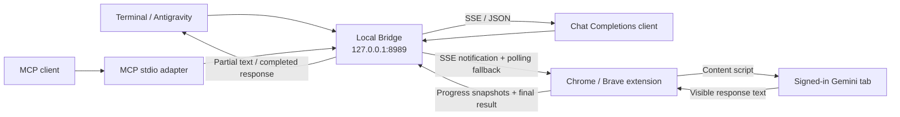

<div align="center">

# Gemini Argon Web Bridge

**จาก Gemini บนเว็บ สู่เครื่องมือที่คุณใช้งานทุกวัน**

เรียกใช้ Gemini session ของคุณผ่าน Terminal, Antigravity, MCP และ Chat Completions API<br>
พร้อมสตรีมข้อความจากหน้าเว็บ และ bridge ที่ทำงานบนเครื่องคุณ

[](https://github.com/TheerasakPing/gemini-argon-web-bridge/actions/workflows/test.yml)
[](https://github.com/TheerasakPing/gemini-argon-web-bridge/releases)
[](LICENSE)

Node.js 20+ · Python 3.9+ · Manifest V3 · ไม่มี npm/pip dependencies

[ติดตั้ง](#quick-start) · [คำสั่งใช้งาน](#usage) · [เชื่อมต่อเครื่องมือ](#integrations) · [สถาปัตยกรรม](#how-it-works) · [แก้ปัญหา](#troubleshooting)

</div>

---

Argon เชื่อม CLI เข้ากับแท็บ Gemini ที่คุณล็อกอินไว้ ผ่าน extension สำหรับ Chrome/Brave
คุณเลือกโมเดลจากหน้าเว็บ ส่ง prompt จาก Terminal และรับข้อความกลับระหว่างที่หน้าเว็บแสดงคำตอบ
โดยไม่ต้องตั้งค่า Gemini API key

> [!IMPORTANT]
> **Argon คือชื่อ bridge ไม่ใช่ชื่อโมเดลที่ระบบรับรอง**
> ระบบใช้ได้เฉพาะโมเดลและโควตาที่บัญชีคุณมีสิทธิ์ ไม่ปลดล็อกแพ็กเกจเสียเงิน
> และไม่สามารถยืนยัน internal model ID จากข้อความบนหน้าเว็บได้
> คำถามและคำตอบยังประมวลผลผ่านบริการ Gemini ของ Google

## Why Argon

| ความสามารถ | สิ่งที่ได้ |
| :--- | :--- |
| **Terminal streaming** | แสดงข้อความตามการอัปเดตของหน้าเว็บ เปิดเป็นค่าเริ่มต้น |
| **เริ่มใช้งานง่าย** | Installer สร้าง token, ติดตั้ง CLI และเปิดหน้า setup ให้ |
| **ใช้ conversation เดิมได้** | สนทนาต่อในแท็บที่เลือก หรือใช้ `--new` เพื่อเริ่มใหม่ |
| **รับข้อมูลจาก workflow เดิม** | รองรับ piped stdin, ไฟล์ข้อความหลายไฟล์ และผลลัพธ์ JSON |
| **เชื่อมต่อ agent** | มี Antigravity skill, MCP tools และ Chat Completions endpoint |
| **ติดตามงานได้** | มีสถานะ CLI, animation บนหน้าเว็บ, popup และคำสั่งตรวจ selectors |
| **ควบคุมงานในเครื่อง** | Queue ทำงานทีละงาน พร้อม claim token ป้องกันการรับงานซ้ำ |

## Quick start

### 1. ตรวจ prerequisites

| องค์ประกอบ | ข้อกำหนด |
| :--- | :--- |
| Runtime | Node.js **20+** และ Python **3.9+** |
| Browser | Chrome หรือ Brave **120+** ที่โหลด unpacked extension ได้ |
| Account | ล็อกอิน Gemini และเลือกโมเดลที่บัญชีใช้งานได้ |
| Port | `127.0.0.1:8989` ต้องว่าง หรือมี Argon instance ที่ใช้งานอยู่ |
| Installer บน Unix | มี `curl` และ `tar` |

```sh
node --version
python3 --version
```

### 2. ติดตั้งและเปิด setup

**macOS / Linux**

```sh
curl -fsSL https://raw.githubusercontent.com/TheerasakPing/gemini-argon-web-bridge/main/install.sh | sh
```

**Windows PowerShell**

```powershell
& ([scriptblock]::Create((Invoke-WebRequest -UseBasicParsing https://raw.githubusercontent.com/TheerasakPing/gemini-argon-web-bridge/main/install.ps1).Content))
```

Installer จะติดตั้ง CLI และ skill, สร้าง token เฉพาะเครื่อง, เพิ่ม User PATH,
เริ่ม background bridge และพยายามเปิดหน้า setup พร้อม Gemini
บน macOS จะเลือก Brave Beta → Brave → Chrome ตามแอปที่ติดตั้งไว้
บนระบบอื่นจะใช้ browser เริ่มต้น จึงควรตั้งให้เป็น Chrome/Brave หรือเปิดหน้าที่แสดงเอง

หากต้องการตรวจ source ก่อนรัน ใช้วิธี [ติดตั้งจาก source](#installation-options)

### 3. เชื่อม extension ครั้งแรก

1. เปิด `brave://extensions` หรือ `chrome://extensions` → เปิด **Developer mode** → **Load unpacked** → เลือกโฟลเดอร์ `extension` ตาม path ที่ installer แสดง
2. เปิด Gemini ใน browser/profile เดียวกัน ล็อกอิน เลือกโมเดล และเว้นช่องพิมพ์ว่าง

| ระบบ | ตำแหน่ง extension เริ่มต้น |
| :--- | :--- |
| macOS / Linux | `~/.gemini/config/skills/argon/extension` |
| Windows | `%USERPROFILE%\.gemini\config\skills\argon\extension` |

> [!NOTE]
> การกด **Load unpacked** ครั้งแรกต้องทำในเบราว์เซอร์เอง
> Installer ไม่ติดตั้ง extension โดยข้ามขั้นตอนอนุญาตของเบราว์เซอร์
> เก็บโฟลเดอร์ติดตั้งไว้ เพราะ unpacked extension อ่านไฟล์จากตำแหน่งนี้

### 4. ตรวจสถานะและเริ่มถาม

เปิด Terminal ใหม่หาก shell ปัจจุบันยังไม่รู้จัก `argon`

```sh
argon --status
argon "อธิบายวงจรน้ำเป็นภาษาไทย"
```

ตรวจผลจาก `argon --status`:

| Field | ความหมาย |
| :--- | :--- |
| `server: "ready"` | Local server ตอบสนองแล้ว |
| `extensionConnected: true` | มี extension ติดต่อกับ server ล่าสุด |
| `ready: true` | Extension รายงานว่ามีแท็บ Gemini พร้อมรับงาน |
| `modelVerified: false` | ยังไม่ได้ยืนยัน internal model ID |

**ครั้งถัดไป เริ่ม bridge และเปิด Gemini ด้วยคำสั่งเดียว:**

```sh
argon --start
```

## Usage

### ถามจาก Terminal

```sh
# สนทนาต่อในแท็บเดิม
argon "ช่วยอธิบาย Server-Sent Events พร้อมตัวอย่าง"

# เลือกไฟล์จากโฟลเดอร์ปัจจุบันอัตโนมัติ (default)
argon "ทำความเข้าใจโปรเจคนี้จากสิ่งที่มีตอนนี้"

# คำถามทั่วไป โดยไม่แนบไฟล์อัตโนมัติ
argon --no-auto "ช่วยอธิบาย Server-Sent Events"

# เปิด conversation ใหม่ก่อนส่ง
argon --new "ออกแบบ REST API สำหรับระบบจองห้องประชุม"

# ส่ง source code ผ่าน stdin
cat app.py | argon "รีวิวโค้ดนี้และชี้จุดที่ควรแก้"

# แนบไฟล์ข้อความหลายไฟล์
argon -f requirements.md -f schema.sql "ตรวจความสอดคล้องของ requirements กับ schema"

# เลือกแท็บจาก ID หรือส่วนหนึ่งของชื่อแท็บ
argon --tabs
argon --tab work "สรุปสิ่งที่คุยกันใน conversation นี้"

# รับผลลัพธ์ JSON เมื่อคำตอบครบ
argon --json "สรุปข้อดีและข้อจำกัดของ SQLite"
```

`--file` และ stdin จะถูกอ่านเป็นข้อความแล้วรวมใน prompt
ไม่ได้อัปโหลดไฟล์แนบผ่าน UI ของ Gemini และไม่รองรับไฟล์ภาพหรือไฟล์ binary ด้วยวิธีนี้

**Auto context เปิดเป็นค่าเริ่มต้น** เมื่อส่ง prompt ธรรมดา CLI จะเลือกไฟล์จาก working directory
โดยให้ README, dependency manifests และ entrypoint มาก่อน และจัดอันดับชื่อไฟล์ที่ตรงกับคำถาม
เช่น `fix login` จำกัด 8 ไฟล์ รวม 24,000 ตัวอักษร และ 6,000 ตัวอักษรต่อไฟล์
ชื่อไฟล์ที่เลือกแสดงบน stderr; ไฟล์ยาวมีเครื่องหมาย `[truncated]`
เป็นข้อมูลบางส่วนของโปรเจค จึงไม่ได้รับประกันว่าโมเดลจะเห็นทุก module หรืออ่านไฟล์เพิ่มเองได้

ใน Git repository จะเคารพ ignore rules สำหรับไฟล์ untracked; ไฟล์ tracked ยังเป็น candidates ตามปกติ
ข้าม hidden files, symlinks, binary, generated directories, lockfiles และชื่อ/รูปแบบ credential ที่รู้จัก
นอก Git จะค้นหาแบบจำกัดความลึกและจำนวนไฟล์ โดยไม่ได้ตีความ `.gitignore`
ไม่สแกนเมื่อ working directory เป็น home หรือ filesystem root
ตัวกรองไม่รับประกันว่าจะตรวจพบ secret ทุกรูปแบบ ตรวจชื่อไฟล์ที่เลือกก่อนใช้กับข้อมูลอ่อนไหว

ใช้ `--no-auto` เพื่อปิดเฉพาะคำสั่ง หรือ `export ARGON_AUTO_CONTEXT=0` เพื่อปิดเป็น default
เมื่อระบุ `-f` หรือมี stdin จะใช้ข้อมูลที่ระบุแทน auto context; ใช้ `--auto` เพื่อรวมทั้งสองแบบ

### Rust agent harness (experimental)

Harness เพิ่มวงจรอ่านโปรเจค เรียก tool และส่งหลักฐานกลับไปให้ Gemini ทำงานต่อ
ออกแบบจากแนวคิด permission/hooks ของ Claude Code, evidence/resume ของ Codex,
small core/session events ของ Pi, provider separation ของ Jcode และ stale-edit protection ของ OMP
รายละเอียดแหล่งอ้างอิง ข้อแลกเปลี่ยน และ roadmap อยู่ใน [PLAN.md](PLAN.md)

ติดตั้งจาก source checkout (ต้องมี Cargo/Rust 1.89+; ทดสอบในเครื่องด้วย Rust 1.95):

```sh
python3 scripts/install.py --with-harness --no-open
```

หรือติดตั้งจาก bootstrap โดยส่ง `--with-harness` ไปยัง installer:

```sh
curl -fsSL https://raw.githubusercontent.com/TheerasakPing/gemini-argon-web-bridge/main/install.sh | sh -s -- --with-harness --no-open
```

```sh
# ค่าเริ่มต้นอ่านอย่างเดียว และอ่านไฟล์เพิ่มได้หลายรอบ
argon agent "ทำความเข้าใจโปรเจคนี้ อธิบาย flow หลัก พร้อมอ้างไฟล์"

# เปิดสิทธิ์เสนอแก้ไขและรัน command; แต่ละ action ยังต้องอนุมัติใน terminal
argon agent --allow-edit --allow-commands "แก้ bug แล้วทดสอบ"

# ระบุแท็บเมื่อมี Gemini พร้อมใช้งานมากกว่าหนึ่งแท็บ
argon agent --tab 123 "สำรวจโปรเจค"

# ดู session / ทำต่อเมื่อไม่มี pending intent / แตก session ใหม่แบบ read-only
argon sessions
argon resume SESSION_ID
argon fork SESSION_ID --task "ลองแนวทางอื่น"

# ตรวจงานที่ process หยุดกลางทางโดยไม่ replay tool
argon recover SESSION_ID
argon recover SESSION_ID --reconcile
# ยอมรับว่าผลงานที่ตรวจยืนยันไม่ได้ยังไม่ทราบผล
argon recover SESSION_ID --abandon "abandon SESSION_ID"

# events แบบ JSONL สำหรับเชื่อมเครื่องมือ (ไม่เปิด approval แบบอัตโนมัติ)
argon agent --json --max-turns 10 "ตรวจโครงสร้างโปรเจค"
```

- Tools: `list_files`, `read_file`, `search_text`, `git_diff`, `edit_file`, `create_file`, `run_command`
- Read/search ใช้ ignore rules, ข้าม hidden/sensitive/generated paths และไม่ตาม symlink
- ก่อนเริ่มงาน harness สแกนรายชื่อไฟล์ทั้งโปรเจกต์และใส่ `PROJECT OVERVIEW` ลงใน prompt
  ประกอบด้วยจำนวนไฟล์, stack จาก manifest (`Cargo.toml`, `package.json`, `go.mod`, `pyproject.toml` ฯลฯ),
  เอกสารหลัก (`README.md`, `AGENTS.md`, `PLAN.md`, `SKILL.md`) และโฟลเดอร์ระดับบน
  โปรเจกต์ใหญ่จึงยังเห็น manifest แม้รายการไฟล์ใน prompt ถูกตัดเหลือ 160 ไฟล์
- Edit ต้องอ่านไฟล์ก่อน ใช้ whole-file SHA-256 และ exact text anchor; create ไม่เขียนทับไฟล์เดิม
- แสดง unified diff ก่อนอนุมัติ edit/create และตรวจ SHA-256 ซ้ำก่อนเขียน
- `git_diff` เปรียบเทียบ HEAD กับ working copy ของ tracked text file ที่ระบุหนึ่งไฟล์
  ใช้ `/usr/bin/git` ที่เชื่อถือได้และ deadline 5 วินาที ไม่ค้น executable จาก PATH
  ยังไม่รองรับ Windows, deleted/untracked files หรือ staged-only view
- Command ใช้ argv, timeout และ process cleanup พร้อม macOS `sandbox-exec` เป็นค่าเริ่มต้น
  เมื่อเปิด `--allow-commands`; จำกัดอ่าน/เขียนใน workspace และปิด network
  อนุญาตอ่าน system runtime prefixes `/System`, `/usr`, `/bin`, `/sbin`, `/Library/Apple`
  รวม `/private/var/db/dyld` และ filesystem metadata จึงไม่ใช่การแยกข้อมูลทุกไฟล์บนเครื่อง
  แพลตฟอร์มที่ไม่รองรับจะหยุด; `--no-sandbox` เป็นการเลือกใช้สิทธิ์บัญชีผู้ใช้โดยชัดเจน
  `python` หรือ `python3` ที่พิมพ์เปล่าๆ จะรันเป็น `/Library/Developer/CommandLineTools/usr/bin/python3`
  เพราะ Homebrew ถูก sandbox บล็อก และ `/usr/bin/python3` เป็น xcrun shim ที่ต้องเขียน cache
  จึงอนุญาตอ่านเฉพาะ `/Library/Developer/CommandLineTools` เพิ่ม; ถ้าไม่มี CommandLineTools จะใช้คำสั่งตามที่ระบุ
- stdout/stderr ของ command แสดงหลังจบและตรวจ secret แบบ bounded buffer; ข้อความ Gemini ยัง stream ระหว่างตอบ
- Session journal เก็บใต้ `~/.local/state/argon/sessions` หรือ `$XDG_STATE_HOME/argon/sessions`
- ค่า default: 20 model turns, 900 วินาทีรวม, prompt budget 85KB; ถึง budget จะเก็บ session และหยุด
- บันทึก intent ก่อนส่ง prompt/ใช้ tool และเก็บ model answer ก่อน parse
  `recover --reconcile` ตรวจ job หรือ file hash แล้วบันทึกเฉพาะผลที่ยืนยันได้ โดยไม่รัน tool ซ้ำ
  command ที่หยุดกลางทางยังถือว่าไม่ทราบผล ต้องตรวจผลเองก่อนใช้ `--abandon`
  การ abandon ไม่ยกเลิกงานภายนอก และ job เก่าที่ bridge ลบจากหน่วยความจำแล้วจะกู้คำตอบไม่ได้
- ทุก model turn เปิด fresh chat พร้อม bounded evidence บนแท็บที่ lease ไว้
  ขณะถือ lease ordinary CLI/API จะส่งคำถามแทรกไม่ได้
- Lease ต่ออายุระหว่างรอโมเดล มีอายุ 30 นาที; ถ้า process crash ให้ตรวจสถานะก่อนใช้ใหม่
  lease ที่หมดอายุจะคืนได้เมื่อ bridge ไม่มีงานค้าง
- Streaming เป็นข้อความ progress ที่หน้าเว็บส่งมาจริง; control JSON ซ่อนจากหน้าปกติ
  ถ้าโมเดลเขียนคำตอบทั้งหมดไว้ใน `final.text` harness ถอดข้อความจาก JSON string ที่ยังมาไม่ครบ
  (รวม `\uXXXX` และ surrogate pair) และพิมพ์ตามช่องว่าง ก่อน envelope จะปิด
  ตัวตรวจว่าข้อความ "แสดงแล้ว" เทียบเฉพาะตัวอักษรและตัวเลข เพราะหน้าเว็บตัด markdown ออก
  โมเดลบางครั้งเขียน prose กับ `final.text` ไม่ตรงกัน ทำให้พิมพ์สองชุด
- ยังไม่มี sandbox สำหรับ Linux/Windows, LSP/DAP, full-screen TUI, executable plugins, autonomous subagents,
  interactive session tree หรือ automatic context compaction
- รุ่นนี้เป็น experimental; automated fixtures และ live Brave verification ต้องรายงานแยกกัน

ชุด live acceptance รันกับแท็บ Gemini ที่พร้อมใช้งานจริง ใช้ disposable projects 10 งานแบบ serial
สุ่ม source แล้วตรวจข้อสรุปโดยไม่เฉลยคำตอบใน prompt ตรวจหลาย partial ขณะ job ยัง generating
และหยุดเมื่อ bridge ไม่พร้อมหรือ acceptance ของงานไม่ผ่าน:

```sh
python3 tests/live_harness.py \
  --binary /Volumes/Data/dot-cache/argon/bin/argon-harness \
  --output /tmp/argon-live-acceptance
```

รายงานต้องมีอย่างน้อย 9/10 งานผ่านก่อนยกระดับ stable; `--count 1` ใช้ smoke test
แต่ไม่นับว่าผ่าน gate เต็ม ชุดนี้อ่านอย่างเดียวและไม่อนุมัติ mutation แทนผู้ใช้

ถ้าติดตั้งทับ daemon รุ่นเก่าแล้ว `argon agent` แจ้งว่า protocol ไม่พร้อม
ให้รอ jobs จบก่อน restart daemon จากนั้นตรวจ `argon --status` ว่ามี `agentProtocol: 1`
หลังอัปเดตเป็น extension 1.1.10 ให้รัน `python3 scripts/install.py` ก่อน (Brave โหลดจากโฟลเดอร์ติดตั้ง) แล้วกด Reload ใน `brave://extensions` และ refresh Gemini
เพื่อเปิดใช้การผูกงานกับ numeric tab ID, document และ conversation
หากผู้ใช้เปลี่ยนหน้า ปิดแท็บ หรือ reload ระหว่างตอบ งานจะหยุดพร้อม error และทิ้งคำตอบที่ยืนยันเจ้าของไม่ได้

### คำสั่งที่ใช้บ่อย

| คำสั่ง / option | การทำงาน |
| :--- | :--- |
| `--start` | เริ่ม server ถ้ายังไม่รัน และเปิด Gemini |
| `--setup` | เปิดหน้า extension setup และ Gemini อีกครั้ง |
| `--status` | แสดงสถานะ server, extension และแท็บ |
| `--doctor` | ตรวจ editor, ปุ่มส่ง และปุ่ม Stop บนหน้าเว็บ |
| `--new`, `-n` | เปิด conversation ใหม่ก่อนส่ง prompt |
| `--file PATH`, `-f PATH` | เพิ่มไฟล์ข้อความใน prompt; ระบุซ้ำได้ |
| `--no-auto` | ปิดการเลือกไฟล์อัตโนมัติจาก working directory |
| `--auto` | เปิด auto context แม้มี `-f`, stdin หรือปิดผ่าน environment |
| `--tab ID_OR_TITLE` | เลือกแท็บด้วย ID หรือชื่อบางส่วน |
| `--force` | เก็บ draft ชั่วคราว ส่ง prompt แล้วคืน draft เดิม |
| `--no-stream` | รอคำตอบครบก่อนแสดง |
| `--json` | แสดง job result เป็น JSON โดยไม่พิมพ์ partial text |
| `--no-spinner` | ปิด animation ใน Terminal |
| `--history 10 --grep TEXT` | ค้นประวัติงานล่าสุด |
| `--timeout SECONDS` | กำหนดเวลารอฝั่ง CLI; ค่าเริ่มต้น 190 วินาที |
| `--mcp-config` | แสดง configuration สำหรับ MCP client |

ดู options ทั้งหมดด้วย `argon --help`

### Streaming ทำงานอย่างไร

Extension อ่านเนื้อคำตอบที่แสดงบนหน้าเว็บประมาณทุก **100 ms**
แล้วส่ง partial text กลับ bridge ส่วน CLI ตรวจอัปเดตประมาณทุก **100 ms**
และ flush ข้อความแต่ละช่วงเมื่อพบ whitespace เช่น space, tab หรือ newline
ส่วนท้ายที่ยังไม่พบตัวคั่นจะถูกส่งเมื่อมีข้อความเพิ่มหรือเมื่องานจบ

- เริ่มสตรีมได้เมื่อเว็บแสดง **เนื้อคำตอบ** แล้ว; ช่วง thinking ที่ยังไม่มีคำตอบจึงอาจเงียบ
- ใน agent run ช่วงเงียบประมาณ 8 วินาทีก่อนคำตอบสุดท้ายมักเป็นเวลาที่โมเดลคิดกับ prompt ขนาดใหญ่
  ไม่ใช่ bridge หรือ extension; ทดสอบ `/ask` ตรงแล้วข้อความโตทุกประมาณ 0.5 วินาที
- นี่คือ DOM streaming ไม่ใช่ token stream โดยตรงจากโมเดล จังหวะขึ้นกับการ render ของเว็บ
- หากข้อความยาวไม่มี whitespace อาจต้องรอจนพบตัวคั่นหรือจนงานจบ
- หากเว็บย้อนแก้ส่วนที่ CLI พิมพ์แล้ว CLI อาจพัก partial output และส่งคำตอบฉบับเต็มเมื่อจบ
- โปรแกรมที่ครอบ CLI อาจ buffer stdout เพิ่ม แม้ Argon จะ flush แล้ว
- เมื่อพบ ancestor process ชื่อ `agy` ที่มี TTY บน macOS/Linux ระบบจะส่งข้อความเข้า TTY นั้นด้วย; GUI/headless session ไม่มี TTY ให้ส่งตรง

## Integrations

### Antigravity skill

Installer วาง [SKILL.md](SKILL.md) ที่ `~/.gemini/config/skills/argon/SKILL.md`
เปิด session ใหม่หรือ reload skills ใน client แล้วเรียก:

```text
/argon อธิบาย SSE พร้อมตัวอย่าง
/argon --status
```

การค้นพบ skill และการแสดง slash command ขึ้นกับ agent client
หาก client ไม่แสดง `/argon` ให้เรียก `argon` ผ่าน Terminal หรือใช้ MCP

### MCP

```sh
argon --mcp-config
```

คัดลอก JSON object ที่คำสั่งแสดงเข้า configuration ของ MCP client
คำสั่งจะระบุ absolute path ของ Node และ `mcp/server.mjs` สำหรับเครื่องที่ติดตั้งแล้ว

| Tool | หน้าที่ |
| :--- | :--- |
| `ask_gemini` | ส่ง prompt; รองรับ `new_chat`, `tab` และ `timeout_s` |
| `argon_status` | อ่านสถานะการเชื่อมต่อ |
| `argon_history` | อ่านประวัติ; รองรับ `limit` และ `q` |

**MCP tool `ask_gemini` ส่งผลลัพธ์เมื่อคำตอบเสร็จ**
หากต้องการ partial text ระหว่างตอบ ให้ใช้ CLI หรือ streaming Chat Completions endpoint

### Chat Completions API

- Base URL: `http://127.0.0.1:8989/v1`
- Model alias: `gemini-web`
- Authentication: `Authorization: Bearer <ค่าจาก bridge/token>`

ตัวอย่าง Python standard library สำหรับรับ SSE โดยอ่าน token จากไฟล์ในเครื่อง:

```python
import json
from pathlib import Path
from urllib.request import Request, urlopen

root = Path.home() / ".gemini/config/skills/argon"
token = (root / "bridge/token").read_text().strip()

request = Request(
    "http://127.0.0.1:8989/v1/chat/completions",
    data=json.dumps({
        "model": "gemini-web",
        "messages": [{"role": "user", "content": "อธิบาย SSE เป็นภาษาไทย"}],
        "stream": True,
        "argon_new_chat": True,
    }).encode("utf-8"),
    headers={
        "Authorization": f"Bearer {token}",
        "Content-Type": "application/json",
    },
)

with urlopen(request, timeout=200) as response:
    for line in response:
        print(line.decode("utf-8"), end="", flush=True)
```

Endpoint รองรับรูปแบบ Chat Completions บางส่วน:

- รองรับ text messages, `stream` และ options `argon_new_chat`, `argon_tab`, `argon_force`
- `model` เป็น alias ใน response; **ไม่เปลี่ยนโมเดลที่เลือกในหน้าเว็บ**
- หลาย messages จะถูกแปลงรวมเป็น prompt เดียว ไม่ใช่ model conversation roles ที่แยกจากกัน
- ไม่รองรับ tool calling, structured-output guarantees หรือ multimodal input
- ไม่ได้วัด token usage; ค่า usage ใน non-streaming response เป็น `0`

<details>
<summary><strong>HTTP endpoint reference</strong></summary>

ทุก endpoint ต้องใช้ bearer token ยกเว้น `GET /health`

| Method | Endpoint | หน้าที่ |
| :--- | :--- | :--- |
| `GET` | `/health` | สถานะ server และสถานะล่าสุดจาก extension |
| `POST` | `/ask` | สร้าง job จาก `prompt` และ `options`; คืน `202` พร้อม job ID |
| `GET` | `/jobs/:id` | อ่านสถานะ, partial text และผลลัพธ์ |
| `POST` | `/jobs/:id/cancel` | ยกเลิกเฉพาะงานที่ยังไม่ส่งไป Gemini |
| `POST` | `/doctor` | สร้างงานตรวจ selectors |
| `GET` | `/history?limit=10&q=TEXT` | อ่านประวัติและค้นข้อความ |
| `GET` | `/v1/models` | แสดง alias `gemini-web` |
| `POST` | `/v1/chat/completions` | Chat Completions; รองรับ SSE เมื่อ `stream: true` |
| `GET` | `/events` | SSE แจ้งว่ามีงานให้ extension ตรวจ |
| `GET` | `/api/pending_task` | Extension รายงานสถานะและรับงานผ่าน polling |
| `POST` | `/jobs/:id/progress` | Extension ส่ง phase และ partial text พร้อม claim token |
| `POST` | `/jobs/:id/response` | Extension ส่งคำตอบหรือ error พร้อม claim token |

`/events` ใช้แจ้งงาน ไม่ใช่ช่องสตรีมคำตอบสำหรับ API client

</details>

## How it works



1. **Submit** — CLI หรือ API สร้าง job; bridge จัดคิวให้ทำทีละงาน
2. **Dispatch** — Extension ตรวจงานผ่าน SSE และ polling สำรอง แล้วรับงานพร้อม claim token
3. **Interact** — Content script ใส่ prompt ใน editor ของ Gemini กดส่ง และอ่านคำตอบจาก DOM
4. **Stream** — Partial snapshots กลับเข้า bridge ให้ CLI/API อ่านระหว่างงาน
5. **Complete** — เมื่อเว็บหยุดตอบและข้อความนิ่ง ระบบบันทึกคำตอบฉบับสุดท้าย

Queue ที่ยังไม่ส่งจะถูกบันทึกในเครื่องและกู้คืนได้เมื่อ server restart
งานที่ส่งไปแล้วจะถูกรายงานเป็น error หลัง server restart เพื่อไม่ส่ง prompt ซ้ำโดยอัตโนมัติ
SSE และ polling ช่วยให้กลับมารับงานหลัง service worker ตื่นได้ แต่ยังต้องเปิด browser/profile ที่โหลด extension ไว้

### ขอบเขตการทำงาน

| รายการ | ค่า / พฤติกรรมปัจจุบัน |
| :--- | :--- |
| Bind address | `127.0.0.1:8989` |
| งานพร้อมกัน | 1 งานต่อ bridge |
| งาน queued + running สูงสุด | 50 |
| Prompt สูงสุด | 100,000 characters หลังรวมข้อความ |
| Server job deadline | 180 วินาที รวมเวลารอคิว |
| CLI wait timeout | 190 วินาทีเริ่มต้น; ปรับด้วย `--timeout` |
| ยกเลิกงาน | ยกเลิกได้ก่อน dispatch; งานที่เริ่มในเว็บแล้วเรียกคืนผ่าน bridge ไม่ได้ |
| ประวัติ | เก็บเป็น JSONL; rotate เมื่อขนาดเกินประมาณ 5 MiB |

การเพิ่ม `--timeout` ไม่ได้เพิ่ม server job deadline

## Installation options

### ติดตั้งจาก source

```sh
git clone https://github.com/TheerasakPing/gemini-argon-web-bridge.git
cd gemini-argon-web-bridge
python3 scripts/install.py
```

บน Windows ใช้ `py -3 scripts/install.py` ได้หากติดตั้ง Python Launcher

| Installer option | การทำงาน |
| :--- | :--- |
| `--no-start` | ติดตั้งไฟล์โดยไม่เริ่ม server หรือเปิด browser |
| `--no-open` | เริ่ม server และแสดงสถานะ โดยไม่เปิด browser |
| `--no-path` | ไม่แก้ shell profile หรือ User PATH |

บน macOS/Linux installer เพิ่ม PATH ใน `.zshrc`, `.bashrc` หรือ `.profile` ตาม shell
บน Windows เพิ่มใน User PATH และ bootstrap `install.ps1` จะเพิ่ม PATH ให้ session ที่รันด้วย

### เลือกโฟลเดอร์ติดตั้งเอง

```sh
ARGON_INSTALL_DIR="$HOME/.local/share/argon" python3 scripts/install.py
```

Installer จะเชื่อมตำแหน่ง skill มายังโฟลเดอร์ที่เลือก
บน Unix ใช้ symlink; บน Windows ใช้ directory junction
หากมี skill อยู่คนละตำแหน่งแล้ว installer จะหยุดเพื่อให้เลือกปลายทางให้ตรงกัน
ไม่ย้ายหรือลบ installation เดิมให้โดยอัตโนมัติ

### เริ่มอัตโนมัติเมื่อ login

**macOS / launchd**

```sh
argon --install-service
```

- Service label: `com.argon.bridge`
- Log: `~/Library/Logs/argon-bridge.log`

Linux และ Windows เริ่ม server แบบ background เมื่อใช้ CLI
ยังไม่มี installer สำหรับ systemd หรือ Windows login service

## Updates

1. รันคำสั่งติดตั้งเดิมอีกครั้ง หรืออัปเดต source แล้วรัน `python3 scripts/install.py`
2. ที่หน้า extensions กด **Reload** บนการ์ด Argon แล้วรีเฟรชแท็บ Gemini
3. Restart bridge ที่รันอยู่เพื่อโหลด server code ใหม่ แล้วตรวจด้วย `argon --status` และ `argon --doctor`

ถ้าใช้ launchd บน macOS ให้ restart ด้วย:

```sh
launchctl kickstart -k "gui/$(id -u)/com.argon.bridge"
```

หากไม่ได้ใช้ launchd ให้หยุด process bridge เดิมผ่าน process manager ที่ใช้งาน แล้วเรียก `argon --start`
อัปเดตขณะไม่มี job ทำงาน และเก็บ token เดิมไว้เพื่อให้ server กับ extension ยังจับคู่กัน

## Privacy & security

- **Local transport** — Bridge รับฟังเฉพาะ loopback และตรวจ Host/Origin พร้อม bearer authentication สำหรับ endpoint ที่รับงานหรืออ่านข้อมูล
- **Per-install token** — Installer สร้าง token เฉพาะเครื่องใน `bridge/token` และ `extension/config.js`; อัปเดตซ้ำจะใช้ token เดิม
- **Browser session** — ใช้ session ที่ล็อกอินในเบราว์เซอร์ ไม่ต้องส่ง Google password หรือ cookie ให้ CLI
- **Conversation data** — คำถามและคำตอบถูกส่งให้ Gemini และอาจถูกบันทึกทั้งใน conversation ของ Google และประวัติ bridge ในเครื่อง
- **Local files** — auto context เปิดเป็น default: ไฟล์ที่ CLI เลือกจาก working directory รวมถึง `-f` และ stdin จะถูกส่งไปยัง Gemini เป็นส่วนหนึ่งของ prompt ใช้ `--no-auto` เพื่อส่งเฉพาะข้อมูลที่ระบุ
- **Health visibility** — `GET /health` ไม่ต้องใช้ token และมีชื่อแท็บบางส่วนกับสถานะล่าสุด จึงไม่ควรนำ port นี้ไปเปิดสาธารณะ

| ไฟล์ | เนื้อหา |
| :--- | :--- |
| `bridge/token` | Bearer token สำหรับ client |
| `extension/config.js` | Token สำหรับ extension |
| `bridge/history.jsonl` และ `.1` | ประวัติคำถาม คำตอบ และข้อมูล job |
| `bridge/queue.json` | งานที่ยังไม่เสร็จ; อาจมี prompt และ partial text |
| `bridge/server.log` | Log เมื่อ CLI เริ่ม server |

ไฟล์ runtime เหล่านี้ไม่รวมใน source repository
**อย่าแชร์โฟลเดอร์ติดตั้งหรือ extension ที่ผ่าน installer แล้วทั้งชุด** เพราะมี token และอาจมีประวัติส่วนตัว
หากต้องการแจกจ่าย ให้แชร์ repository หรือ source archive แล้วให้แต่ละเครื่องรัน installer เอง

## Troubleshooting

| อาการ | ตรวจ / แก้ไข |
| :--- | :--- |
| `argon: command not found` | เปิด Terminal ใหม่ หรือใช้ fallback command ด้านล่าง |
| `extensionConnected: false` | ตรวจว่า extension โหลดอยู่ใน browser/profile ที่เปิด และไม่มี error บนการ์ด |
| `ready: false` | เปิด Gemini, ล็อกอิน, รอคำตอบเดิมจบ และเคลียร์ draft |
| `Unauthorized` | Server กับ extension อาจใช้ token คนละชุด; ใช้ installation เดียวกัน แล้ว Reload extension และ restart bridge |
| สถานะค้าง busy ทั้งที่เว็บว่าง | รัน `argon --doctor`; Reload extension แล้วรีเฟรช Gemini เพื่อโหลด content script ปัจจุบัน |
| ยังไม่เห็นข้อความระหว่างตอบ | ดูว่าเว็บแสดงเนื้อคำตอบแล้วหรือยัง ตรวจ `--json` / `--no-stream` และการ buffer ของโปรแกรมที่ครอบ CLI |
| ใช้ MCP แล้วเห็นคำตอบทีเดียว | เป็นพฤติกรรมของ `ask_gemini`; ใช้ CLI หรือ streaming API หากต้องการ partial text |
| ข้อความบางส่วนขาดหาย | Google อาจเปลี่ยน DOM หรือรูปแบบคำตอบ; เก็บผล `--doctor` และแจ้ง issue โดยลบข้อมูลส่วนตัว |
| `Port 8989 is occupied` | ตรวจ process ที่ฟัง port; ปิดเฉพาะ instance ที่ยืนยันแล้วว่าเป็นตัวที่ไม่ต้องการ |
| Job timeout | เปิด Gemini ดูก่อนส่งซ้ำ เพราะ prompt อาจถูกส่งไปแล้ว |
| โหลด extension จาก source แล้วไม่มี `config.js` | รัน installer ก่อน แล้วโหลดโฟลเดอร์ extension จาก **installation path** ที่ installer แสดง |

Fallback หาก PATH ยังไม่พร้อม:

```sh
python3 "$HOME/.gemini/config/skills/argon/scripts/gemini_argon_bridge.py" --status
```

Windows:

```powershell
py -3 "$HOME\.gemini\config\skills\argon\scripts\gemini_argon_bridge.py" --status
```

> [!TIP]
> ปุ่ม Send หรือ Stop อาจไม่แสดงขณะ idle ตามพฤติกรรมหน้าเว็บ
> จึงไม่ควรตัดสินว่าระบบเสียจากผล `--doctor` ของสองปุ่มนี้เพียงอย่างเดียว

ยังแก้ไม่ได้? เปิด [GitHub issue](https://github.com/TheerasakPing/gemini-argon-web-bridge/issues)
พร้อม OS, browser version, extension version, อาการ และผล `argon --status` / `argon --doctor` ที่ลบข้อมูลส่วนตัวแล้ว
ไม่แนบ token, `config.js` หรือประวัติ conversation

## Development

```text
gemini-argon-web-bridge/
├── bridge/server.mjs              # HTTP server, queue, history, SSE
├── extension/                     # Manifest V3, worker, content script, popup
├── scripts/
│   ├── gemini_argon_bridge.py     # CLI, live output, lifecycle helpers
│   └── install.py                 # Installer และ token pairing
├── mcp/server.mjs                 # MCP stdio adapter
├── bin/                           # Shell / Windows launchers
├── tests/                         # Bridge, DOM fixtures, CLI และ installer tests
├── install.sh                     # Bootstrap สำหรับ macOS/Linux
├── install.ps1                    # Bootstrap สำหรับ PowerShell
└── SKILL.md                       # คำแนะนำสำหรับ agent client
```

รันจาก source checkout:

```sh
node --test tests/*.test.mjs
python3 -m unittest discover -s tests -p 'test_*.py'
sh -n install.sh
```

CI รันบน Ubuntu และ macOS ด้วย Node.js 20 และ Python 3.9
ชุดทดสอบครอบคลุม queue/authentication, SSE/polling, partial output timing, DOM extraction,
MCP handshake และการติดตั้งใน HOME จำลองที่มีช่องว่างใน path
PTY tests ใช้บน Unix และข้ามเมื่อไม่มีโมดูล `pty`

**ขอบเขต validation:** Automated tests ใช้ browser fixtures
ไม่ได้รับรองว่า Google DOM ทุกเวอร์ชันทำงานได้
การทดสอบกับ Brave/Gemini จริงต้องมี extension และ session ที่ล็อกอิน
ส่วน Windows installer มีให้ใช้งาน แต่ยังไม่ได้ทดสอบใน CI ของ repo นี้

### Contributing

ก่อนส่ง pull request ให้รันชุดทดสอบ และเพิ่ม regression test เมื่อแก้พฤติกรรมที่ทำให้เกิด bug
อธิบาย browser/DOM ที่เกี่ยวข้องโดยไม่แนบข้อมูลบัญชีหรือ conversation ส่วนตัว
การแก้ selector ควรตรวจทั้ง partial text และคำตอบสุดท้าย เพื่อป้องกันข้อความขาดหรือซ้ำ

## Uninstall

1. หากเปิด login service บน macOS ให้รัน `argon --uninstall-service`
2. หยุด process bridge ที่ยืนยันแล้วว่าฟัง `127.0.0.1:8989`
3. Remove extension จาก browser แล้วสำรองประวัติที่ต้องการเก็บ
4. ลบ installation directory และ launcher `argon`, `argon.cmd`, `argon.ps1` ใน `~/.local/bin`
5. เอาบรรทัดที่มี `# argon-web-bridge` ออกจาก shell profile หรือเอา PATH ที่ installer เพิ่มให้ออกจาก Windows User PATH หากไม่ต้องการใช้อีก

หากใช้ symlink/junction ให้ตรวจปลายทางก่อนลบ
**การลบ installation directory จะลบ token และประวัติในเครื่องด้วย**

## License

[MIT](LICENSE) © 2026 TheerasakPing

โครงการอิสระ ไม่ใช่ผลิตภัณฑ์ทางการของ Google
Gemini และ Chrome เป็นเครื่องหมายการค้าของเจ้าของที่เกี่ยวข้อง
